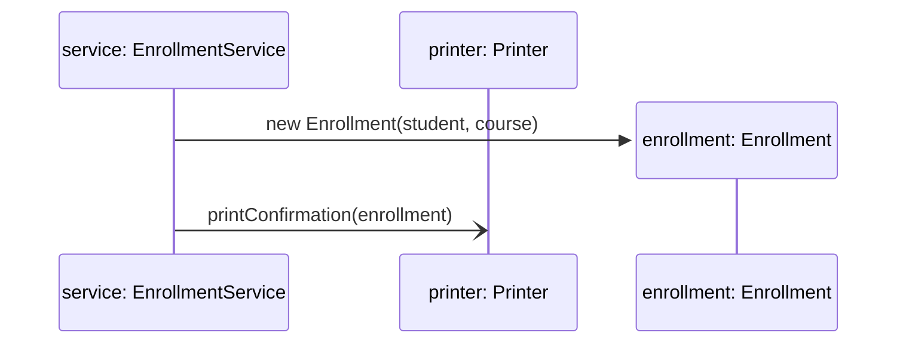
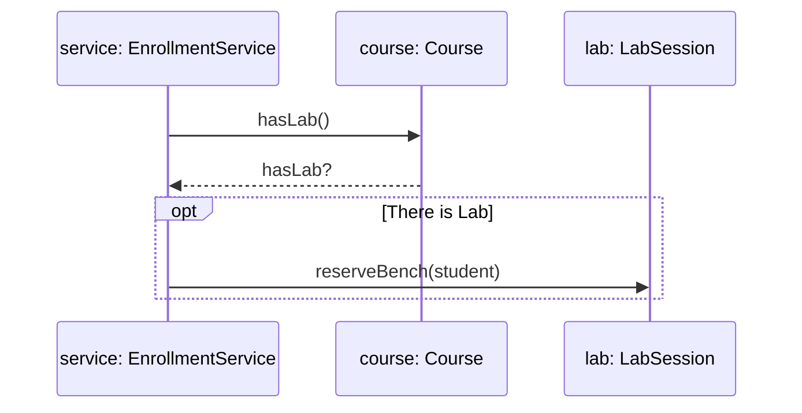
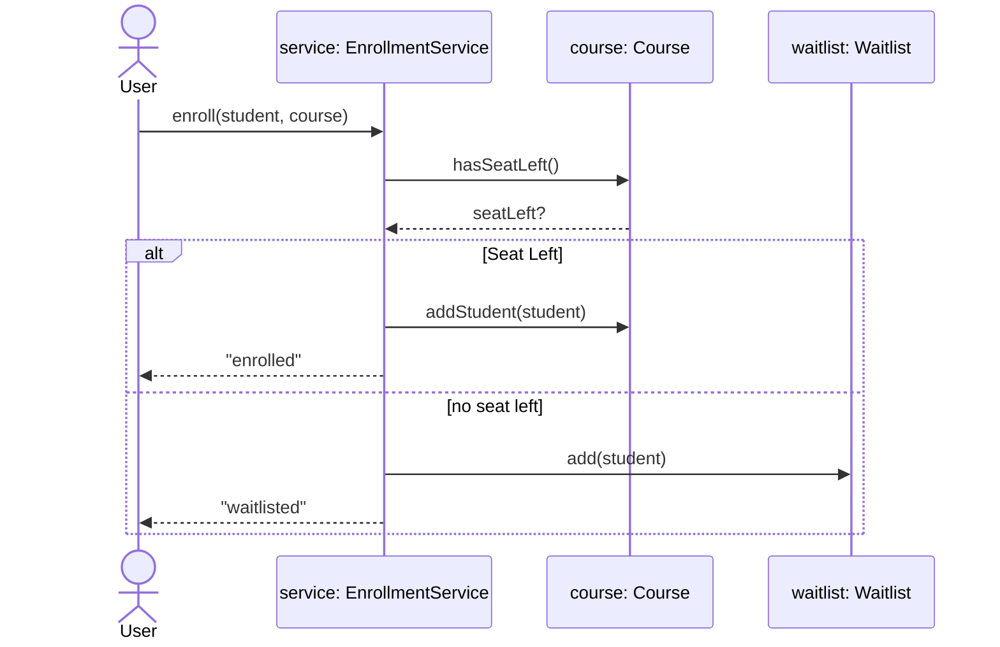
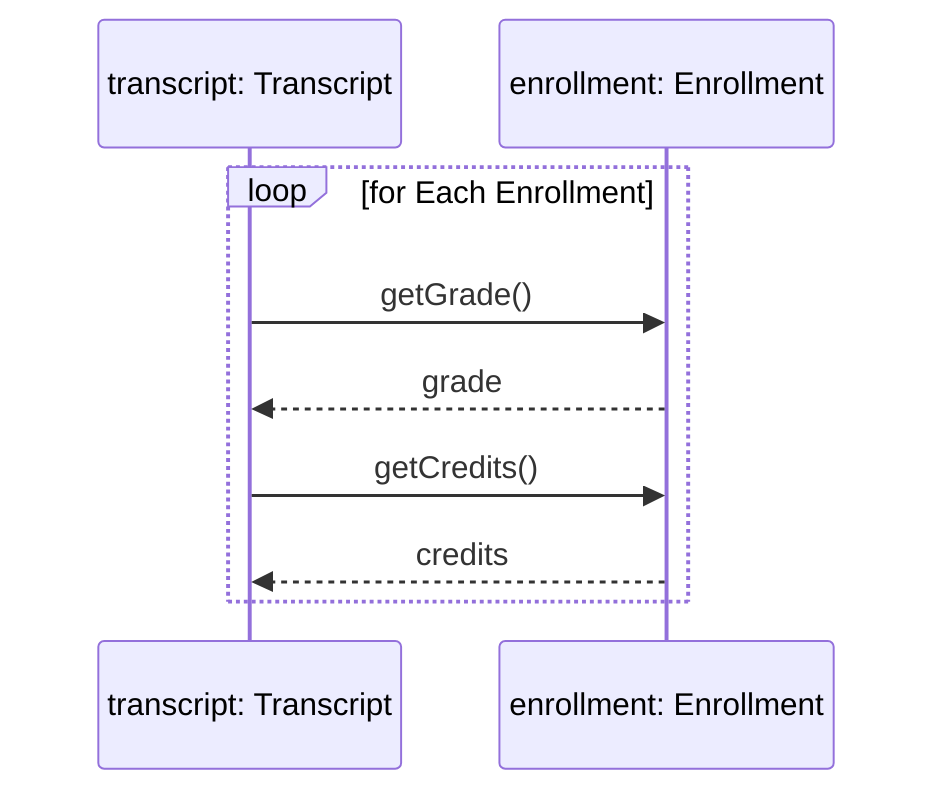
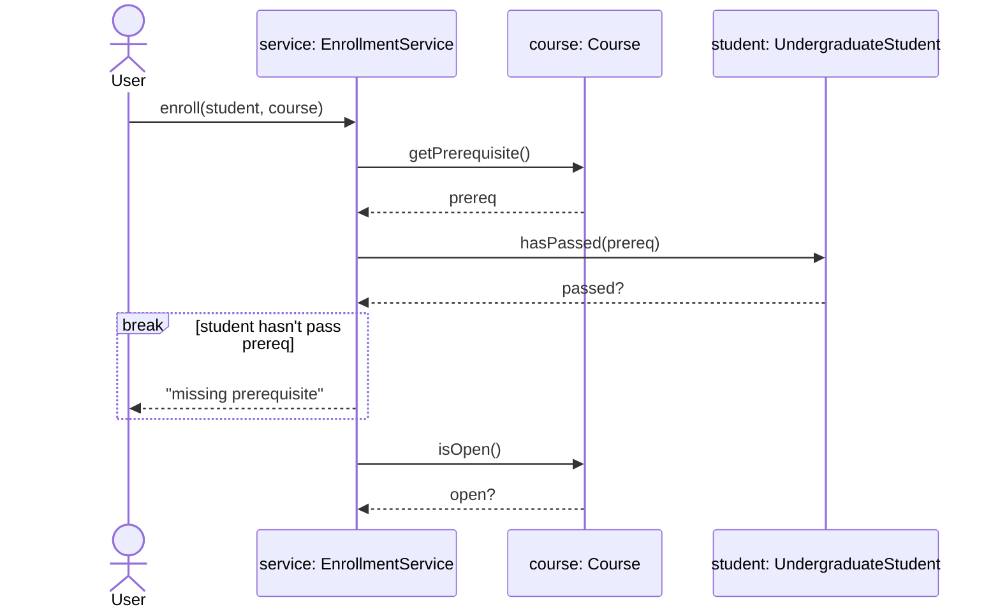
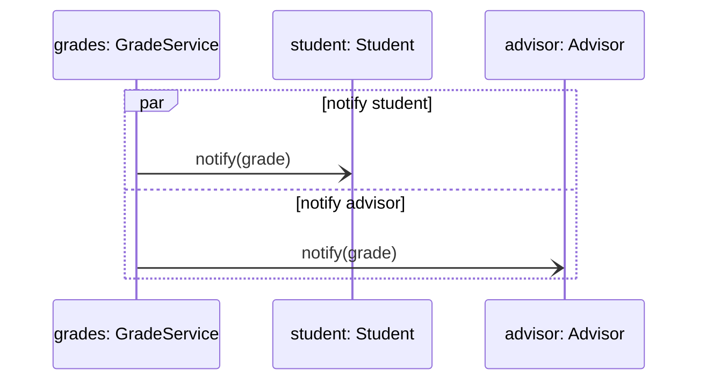

## Exercise 1
(a) true, 6 and dropped

(b) Course must have "removeStudent(Student)" and "getCredits() and UndergraduateStudent must have "removeCredits()"

(c) What will happen is an error. I would add the fragment alt and put the message [isEnrolled]

## Exercise 2



(a) because enrollement was created later with new participant so it appears at it's time of creation

(b) it is drawn with solid line and opened arrow -) because it shouldn.t wait.

## Exercise 3- opt


## Exercise 4- alt


## Exercise 5 - loop


# Exercise 6 - break


# Exercise 7 - par


# Exercise 8

Sentence from the requirements|Fragment|
|---|---|
|"For each course in the student's list, …"|loop|
|"If the student asked for a printed timetable, also print it."|opt|
|"The student pays the fees either by card or by bank transfer."|alt|
|"If registration is closed, refuse and stop."|break|
|"Email the student and the advisor at the same time."|par|

# Exercise 9
 ```mermaid
        sequenceDiagram
            actor Registrar
            participant S as service: WaitlistService 
            participant C as course: Course
            participant W as waitlist: Waitlist
            Registrar->>S: promote(course, waitlist) 
            S->>C: hasSeatLeft()
            C-->S: seatLeft?       
            break no seat left
                 S-->>Registrar: undefined   
            end
            S->>W: next()
            W-->>S: next
            break next is undefined
                 S-->>Registrar: undefined
            end
            S->>C: addStudent(next)
            S-->>Registrar: next

``` 
# Exercise 10

```typescript ...
enrollAll(student: Student, courses: Course[]): number {
      let acceptedCount = 0;
       for (const course of courses) {
        if (course.isOpen()) {
            const credits = course.getCredits();
            if (student.addCredits(credits)) {
            acceptedCount++;
          }
            }
      }
      return acceptedCount;
    }
```
#   Exercise 11

|\#|Line of the diagram|What is wrong|Correction|
|---|---|---|---|
|1|6|line 6 should come after isOpen()|S->>C: isOpen()
S->>E: new Enrollment(student, course)|
|2|8|C->>S wrong arrow used|C-->>S|
|3|10|S->>C: seats = seats - 1 direct method assumption|S->>C: addStudent(Student)|


